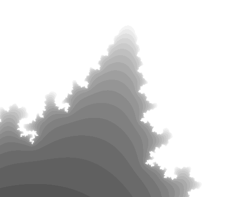

# "Composing Fractals", again

  

## Build & run

This is a little project to be played with on the REPL.
`$ cabal repl` should get you sorted (it will install all dependencies first,
so it might take a bit to run the first time)
