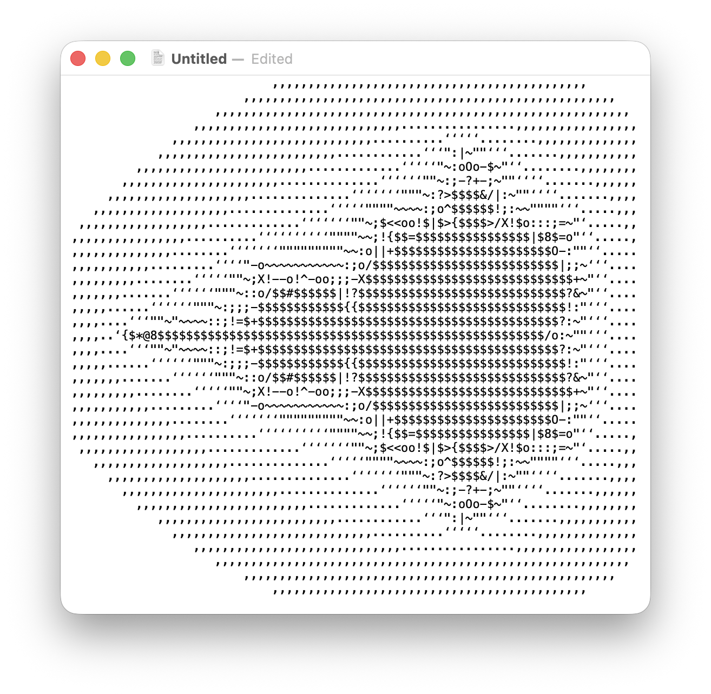
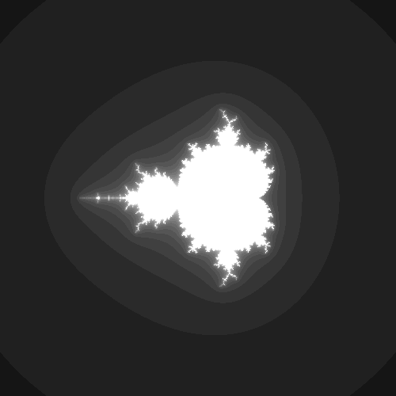

# "Composing Fractals", again

  

Some Haskell code for drawing the Mandelbrot and Julia sets, based on Mark P. Jones's 2004 paper ["Composing Fractals"](https://www.cambridge.org/core/journals/journal-of-functional-programming/article/functional-pearl-composing-fractals/EBF5B1EBB717AFEC0CA84FE8A07C5C24).

Fractals have fascinated me since I was a teenager, so I thought I'd play with this a little while practicing Haskell and functional programming.

The code in this repo can generate both ASCII art like this

  

as well as actual images:

  

The implementation closely follows the paper, so I'm not going to go over it again here.
Here's what I did differently:

* **Rendering with [Juicy Pixels](https://hackage.haskell.org/package/JuicyPixels).** The paper is old, and I'm not sure whether the drawing library it used is still available or maintained. As the author mentions, the particular library doesn't really matter: the program is designed to be modular in that regard. I chose Juicy Pixels because it seemed simple and its API was close to what the paper describes. People on the Haskell Forum also [suggested Brillo, Diagrams and others](https://discourse.haskell.org/t/looking-for-graphics-library-recommendation/15053/2).
* **Choosing the part of the set to draw.** The paper asks for a window size (columns × rows) and two points (lower left and upper right) defining the part of the set to draw. I found that a little inconvenient: if the aspect ratios of the window and the selected area differ, the image gets distorted. So I added a helper that takes a centre point and a radius, builds a square, and adjusts it to match the window's aspect ratio. It then returns the two points, so the image won't be distorted.

Everything else should be quite consistent with the paper.

## Build & run

This is a little project to explore in the REPL. Run `cabal repl` to get started. It will install the dependencies first, so it may take a little while the first time.
